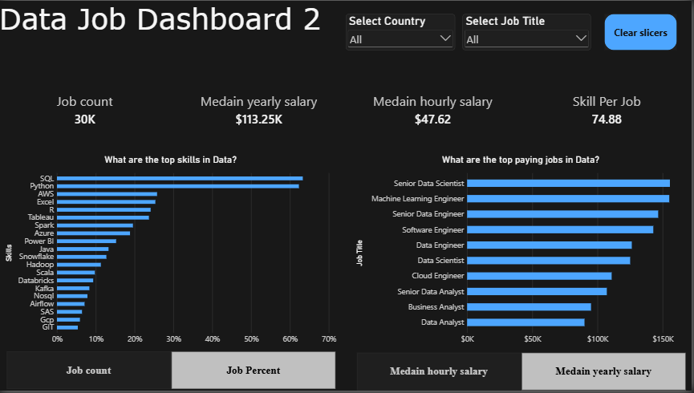

# Introduction

Navigating the data job market can feel like a maze with information scattered everywhere. This dashboard (V2.0) is designed specifically for Job Seekers, Job Transitioners, and Job Swappers to cut through the clutter! Using a real-world dataset of 2024 data science job postings—rich with details on titles, salaries, and locations—this project offers a streamlined, single-page interface to quickly explore crucial market trends and compensation insights.

<video controls src="20261108-1723-24.0011130.mp4" title="Title"></video>

## Dashboard File

You can find the file for the dashboard here: `Project_2/Project_2.pbix`.

## Skills Showcased

This project put key Power BI features into practice. Here's what we mastered:

* 🎨 **Dashboard Design:** Crafting an intuitive and visually appealing dark-themed report layout.
* ⚙️ **Power Query ETL:** Performing data cleaning, shaping, and transformation.
* 🔗 **Data Modeling:** Building efficient data models with star schema principles (`job_postings_fact`, `job_title_dim`, `skills_dim`, `skills_job_dim`, etc.).
* 🧮 **DAX Fundamentals & Advanced Metrics:** Creating custom measures and parameters (`Job count`, `Job Percent`, `Median yearly salary`, `Medain hourly salary`, `Skill Per Job`, `Take home pay`).
* 📊 **Visualizations Utilized:**
  * 📈 **Bar & Column Charts:** For top skills and top-paying jobs comparisons.
  * 🔢 **Cards:** To highlight key performance indicators ($30\text{K}$ jobs, $\$113.25\text{K}$ salary, $74.88$ skills per job).
* 🖱️ **Interactive Features:**
  * 🎚️ **Slicers:** Global filters for Country and Job Title.
  * 🔘 **Buttons & Dynamic Controls:** Clear slicers functionality and interactive metric toggle buttons.

## Dashboard Overview (Version 2.0 - Single Page Focus)

This second iteration consolidates the dashboard into a single, focused page, designed to give job seekers the most critical market insights at their fingertips.

This page acts as your concise mission control for the data job market. It showcases key performance indicators (KPIs) like Job Count, Skills Per Job, Median Yearly Salary, and Median Hourly Salary. You can also quickly see Skill Popularity (by job percent or count) and compare Salaries across different Job Titles, all designed for an efficient overview.

## Conclusion

This updated dashboard (Version 2.0) showcases Power BI's ability to transform extensive job posting data into a powerful, streamlined tool for career analysis. It empowers Job Seekers, Job Transitioners, and Job Swappers by allowing them to filter and explore essential market insights efficiently on a single page, helping them make informed decisions about their next career move.