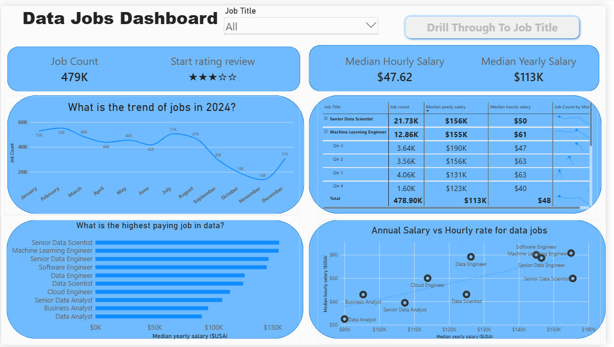
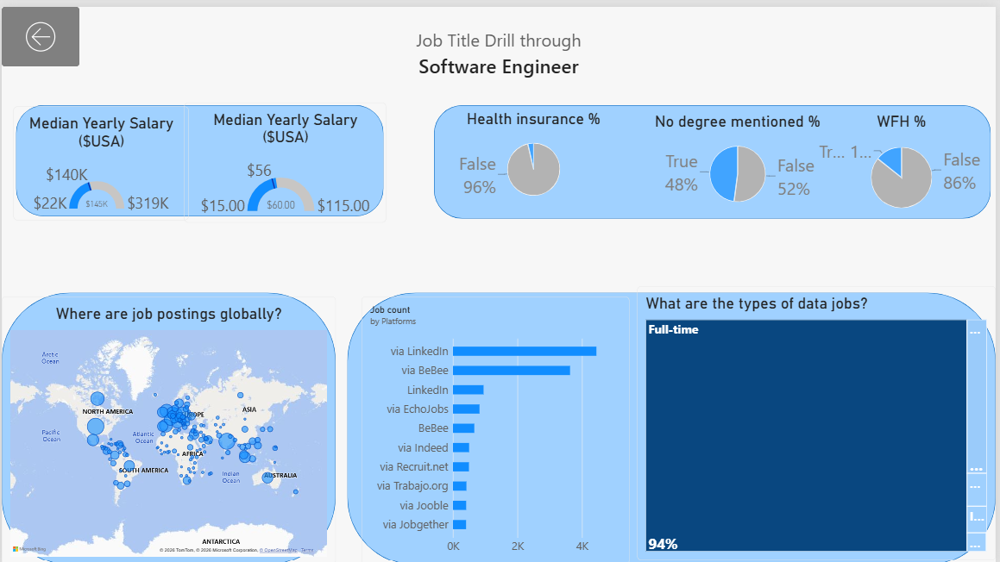

# 📊 Data Jobs Market Analysis Dashboard (Power BI)

## 📌Project Overview: 

The Data Jobs Dashboard is an interactive Power BI report designed to analyse global job market trends, compensation rates, hiring platforms, and role requirements for data professionals in 2024.   By aggregating data across 479K+ job postings worldwide, this project provides actionable insights into salary benchmarks, job volume trends, and specific role requirements (e.g., degree requirements, remote work flexibility, and insurance benefits). 

##   🛠️ Key Features & Visual Highlights

1. Main Overview Page Key Metrics Summary: 479K total job postings analysed.   $113K Median Yearly Salary across all roles.   $47.62 Median Hourly Salary. 

 -  2024 Job Hiring Trend: Line chart showcasing monthly job posting volumes, highlighting seasonal demand spikes during summer and late Q3.

- Highest-Paying Roles Ranking: Comparative bar chart ranking top roles by median yearly salary (e.g., Senior Data Scientist, Machine Learning Engineer, Senior Data Engineer).

- Compensation Matrix: Correlation scatter plot mapping Hourly Rates vs. Annual Salaries across data job titles.
  
- Interactive Breakdown Table: Structured table summarizing total job counts, median yearly salaries, and hourly rates per role.  

    2. Job Title Drill-Through PageSpecific Role Insights (e.g., Software Engineer):Salary Gauge: Range and median target for specific roles ($140K median yearly salary).

- Job Types & Platforms: Breakdown of postings by employment type (94% Full-time) and job sourcing platforms (LinkedIn, BeBee, EchoJobs, etc.).   

- Perks & Requirements: No Degree Mentioned: 48% True / 52% False.   Health Insurance Coverage: 96% False / 4% True.   Work-From-Home (WFH) Availability: 86% False / 14% True.

- Global Job Distribution Map: Geographic representation of job postings worldwide.   

# 💡 Key Insights & TakeawaysTop Compensation: 

1. Senior technical roles like Senior Data Scientist ($156K median) and Machine Learning Engineer ($155K median) command the highest compensation rates.   Degree Flexibility: Nearly half (48%) of postings do not explicitly state a requirement for a formal degree, reflecting a growing focus on practical skills and certifications.  
 
2. Platform Dominance: LinkedIn and BeBee represent the primary distribution channels for global tech and data postings.

   
# 💻 Tech Stack & Tools Used - Business Intelligence Tool:
 
 - Power BI Desktop   Data Modelling: DAX (Data Analysis Expressions) measures for calculated KPIs (e.g., Median Salaries, Job Counts)

 - Data Visualisations: Drill-through filters, Custom Tooltips, Gauge charts, Doughnut charts, Map Visuals 

 ## Skills Showcased
**Data Transformation (ETL) with Power Query:**
Cleaned, shaped, and prepared the raw data for analysis by handling blanks, changing data types, and creating new columns.

**Implicit Measures:** 
Formulated measures to derive key insights and KPIs like Median Yearly Salary and Job Count.

**Core Charts:** 
Utilised **Column, Bar, Line,** and **Area Charts** to compare job counts and track trends over time.

**Geospatial Analysis:** 
Leveraged **Map Charts** to visualise the global distribution of jobs.

**KPI Indicators & Tables:** 
Used **Cards** to display key metrics and **Tables** to provide granular, sortable data.

**Dashboard Design:**
Designed an intuitive and visually appealing layout, exploring both common and uncommon chart types to best tell the data story.

**Slicers:** To dynamically filter the report by Job Title.

**Buttons & Bookmarks:** To create a seamless navigation experience.

**Drill-Through:** To navigate from a high-level summary to a contextual, detailed view.

## Conclusion

This dashboard showcases how Power BI can transform raw job posting data into a powerful tool for career analysis. It allows users to slice, filter, and drill through data to make informed decisions about their career paths.
